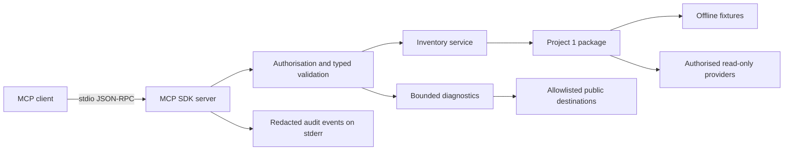

# Infrastructure MCP Server

An independently authored, read-only Model Context Protocol server by **berkeleyo**. It exposes
allowlisted multi-vendor infrastructure discovery, desired-state drift analysis, validation, and
bounded network diagnostics to compatible AI clients. Provider discovery is delegated to the
commit-pinned `multi-vendor-infrastructure-automation` package rather than duplicated here.

> Offline inventory and mocked network boundaries are tested. No live cloud or firewall
> connectivity is claimed or required.

## Architecture



## Tools

| Tool | Purpose |
|---|---|
| `infrastructure_health` | Configuration readiness, explicitly not live connectivity |
| `discover_infrastructure` | Normalized inventory for an allowlisted profile |
| `detect_infrastructure_drift` | Deterministic desired/actual comparison |
| `validate_infrastructure_config` | Project 1 schema validation without live calls |
| `diagnose_dns` | Bounded A, AAAA, CNAME, MX, and TXT lookups |
| `diagnose_tls` | Certificate, SAN, validity, cipher, and protocol inspection |
| `diagnose_http` | Body-free HEAD/GET status, timing, and safe headers |
| `list_available_capabilities` | Configured capabilities without connection claims |

## Install and run

```bash
python3 -m venv .venv
.venv/bin/pip install -e '.[dev]'
INFRA_MCP_CONFIG=examples/server.yaml .venv/bin/infrastructure-mcp-server
```

Example client configuration:

```json
{
  "mcpServers": {
    "infrastructure": {
      "command": "/absolute/path/infrastructure-mcp-server/.venv/bin/infrastructure-mcp-server",
      "env": {"INFRA_MCP_CONFIG": "/absolute/path/infrastructure-mcp-server/examples/server.yaml"}
    }
  }
}
```

The host chooses the executable, configuration, environment, credentials, and OS permissions.
Tool approval prompts are useful UX but are not the security boundary. AI clients can select only
preconfigured aliases—not arbitrary paths, hosts, URLs, or commands.

Run the deterministic offline suite with `scripts/verify.sh`. See [RUNBOOK.md](RUNBOOK.md),
[security](docs/SECURITY.md), and [integration](docs/INTEGRATION.md).

## Lifecycle

**Plan → Build → Test → Deploy → Operate → Improve**: define trust boundaries and least privilege;
implement typed read-only tools; test protocol and adversarial paths; package without cloud changes;
operate with host-controlled profiles and redacted audit events; improve from reviewed evidence.

## Known limitations

- Live providers have not been smoke-tested by this repository.
- Diagnostics deliberately reject redirects, private/reserved addresses, and arbitrary paths.
- HTTP and TLS connect to the validated IP while preserving Host/SNI verification, preventing a
  second hostname resolution. Run the stdio process with network egress controls for defence in depth.
- Stdio is local only; no remote HTTP transport or multi-user authentication is supplied.

