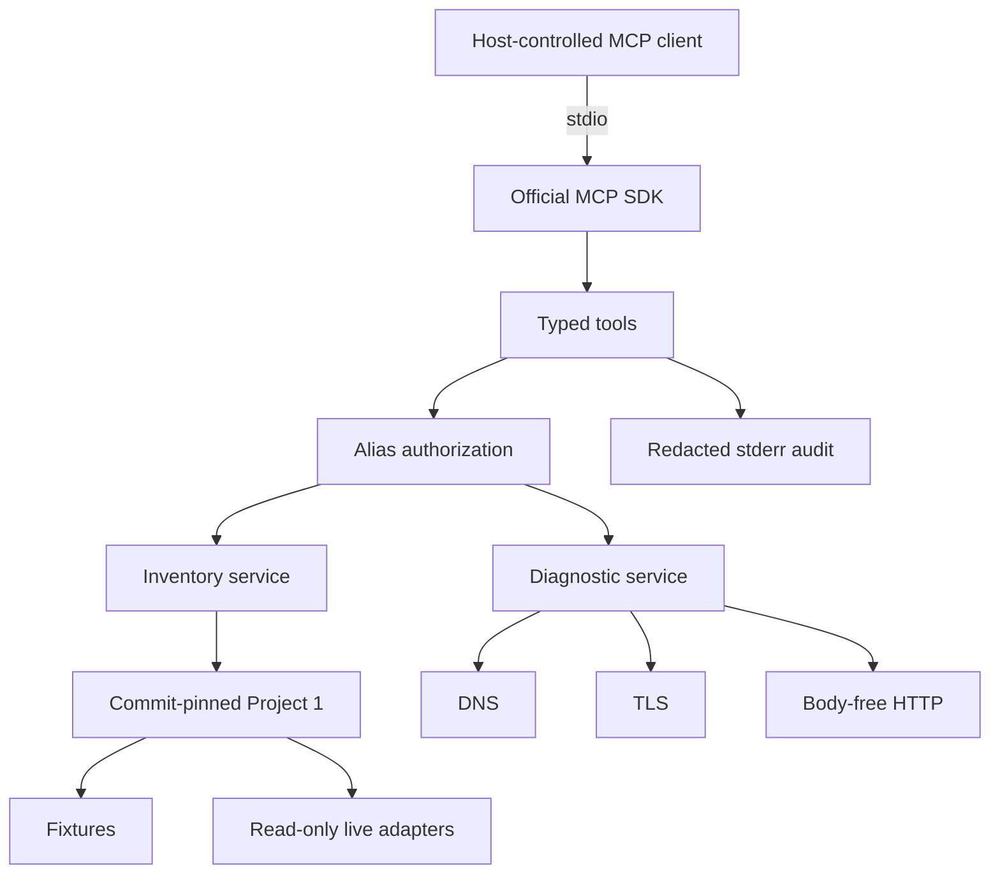

# Architecture

Dependency injection replaces inventory and diagnostic boundaries in tests. A real official SDK
client also launches the packaged stdio process and completes the legacy initialize handshake.

